# Entertainment Real-Time Lakehouse

This project captures synthetic video-streaming events in Apache Kafka, processes them with Apache Flink, and writes Apache Iceberg tables backed by SeaweedFS. Python materializes the Silver and Gold tables and loads Gold into Oracle Database. Trino queries Oracle for analytics and checks its results against Iceberg. The **Entertainment Streaming Analytics** Power BI Project can import the live Trino results or open with bundled synthetic aggregates.

```mermaid
flowchart LR
    P["Synthetic Python producer"] --> K["Kafka · streaming-events"]
    K --> F["Flink SQL · validate, deduplicate, checkpoint"]
    F --> B["Iceberg Bronze · SeaweedFS"]
    B --> S["Iceberg Silver · clean events"]
    S --> G["Iceberg Gold · content, devices, KPIs"]
    G --> O["Oracle Database · transactional MERGE"]
    O --> T["Trino · Oracle connector"]
    G -. "Iceberg reconciliation" .-> T
    T --> BI["Power BI Project · Trino HTTP Import"]
    T -. "Optional verified CSV import" .-> BI
```



The streaming path is continuous through Bronze. Silver, Gold, and Oracle refresh on demand. This lets an 8 GB host run the ingestion and serving phases separately. The Power BI project opens in Demo mode by default and can refresh against Trino or its CSV exports. See the [acceptance record](docs/evidence/README.md) for the validation status of each mode.

## Requirements

| Requirement | Details |
|---|---|
| Host | x86-64 Linux or Windows with Ubuntu on WSL 2 and Docker Desktop Linux containers. The Oracle image in Compose is amd64. |
| Docker | Docker Engine with BuildKit and the Docker Compose v2 CLI or later. |
| Host tools | Git, Bash, `flock`, `timeout`, and standard Linux utilities. Python and Java run in containers. |
| Resources | Allow about 4 GiB for the Docker/WSL environment and reserve 15 GB for images, build layers, and demo data. An 8 GB host can use the staged workflow. |
| Network | The first build downloads images, Maven artifacts, and PyPI dependencies from their public registries. |
| Local ports | Flink UI on `127.0.0.1:8081` and Trino on `127.0.0.1:8080` by default. Kafka, S3, the REST catalog, and Oracle stay on the Compose network. |

The Compose stack uses Kafka 4.4.0, Flink 2.2.1 with Java 21, Iceberg 1.12.0, SeaweedFS 4.53, Oracle AI Database Free Lite 23.26.3.0, and Trino 484. The Oracle image is distributed under the Oracle Free Use Terms. See [Oracle's local container documentation](https://docs.oracle.com/en/database/oracle/agent-memory/26.8/guide/run-locally.html) and the [Trino Oracle connector requirements](https://trino.io/docs/current/connector/oracle.html).

## Run the demo from a clean checkout

Open a Bash shell at the repository root. On WSL, place the checkout on the Linux filesystem for Docker bind mounts.

```bash
scripts/init_env.sh
scripts/run_demo.sh
cat .runtime/exports/streaming_kpis.csv
cat .runtime/exports/reconcile.csv
```

`init_env.sh` creates a private `.env` with unique local credentials. Its defaults are documented in [`.env.example`](.env.example). An existing `.env` is reused. The first build fetches and verifies the five Flink JARs in [`flink/connectors.lock`](flink/connectors.lock). The image contains those JARs, while Git tracks the downloader and checksums.

If the default ports or Compose project name are in use, initialize a separate checkout with a unique project name and different ports before running the demo.

```bash
scripts/init_env.sh entertainment-local-qa 18081 18080
scripts/run_demo.sh
```

Compose scopes the named Kafka, SeaweedFS, and Oracle volumes by project. Each checkout has its own ignored `.runtime/` for Flink recovery state, the Gold publication manifest, and CSV exports. Use a separate checkout for each independent deployment. On a memory-constrained host, run one full demo at a time.

### Expected result

The default run generates 240 deterministic events with run ID `compose-demo`. The following results apply to an empty deployment.

| Check | Expected value |
|---|---:|
| Kafka events acknowledged and read back | 240 |
| Committed Bronze rows and distinct event IDs | 240 each |
| Silver rows | 240 |
| Gold content and device rows | 12 and 4 |
| UTC dates in the daily trend | 7 |
| Content rows in the completion dataset | 12 |
| Plays | 79 |
| Unique viewers of at least one `PLAY` event | 30 |
| Watch time | 17,919 seconds / 298.65 minutes |
| Reconciliation mismatches | 0 for each of the 5 Gold datasets |

The exports cover content popularity, top 10, device engagement, global KPIs, daily trends, content completion, and reconciliation. See the [verified demo evidence](docs/evidence/) and [Power BI setup](powerbi/README.md).

### Open the Power BI project

Open [`Entertainment Streaming Analytics.pbip`](powerbi/Entertainment%20Streaming%20Analytics.pbip) in Power BI Desktop. The version-controlled report uses PBIR and the model uses TMDL. Refresh in **Demo** mode to load the synthetic acceptance dataset. To load the running pipeline, use **Transform data → Edit parameters**, select `Trino` for `DataMode`, and set `TrinoBaseUrl` to the Compose endpoint. The [Power BI guide](powerbi/README.md) includes refresh, validation, and CSV instructions.

### Run or inspect the phases individually

```bash
scripts/start_pipeline.sh
scripts/produce_demo.sh --run-id compose-demo --count 240
scripts/check_pipeline.sh compose-demo-0240 --wait 120
scripts/refresh_lakehouse.sh

scripts/stop_pipeline.sh --flink-only
scripts/start_serving.sh
scripts/export_dashboard.sh
```

- `start_pipeline.sh` builds the Flink and tools images, starts the Kafka broker and SeaweedFS, and calls `init_topics.sh` and `init_iceberg.sh`. The Kafka topic, Iceberg namespaces, and Bronze table are created idempotently. SeaweedFS creates the Iceberg table bucket at startup.
- `refresh_lakehouse.sh` reads a committed Bronze snapshot and creates or refreshes Silver and Gold. `start_serving.sh` stops the Kafka broker to free memory, waits for Oracle, provisions the analytics schema, loads the latest published Gold snapshots, and starts Trino.
- `sync_gold_to_oracle.sh` can rerun the Oracle load while serving. `export_dashboard.sh` reruns all dashboard SQL and exports results after the reconciliation succeeds.

```bash
docker compose --profile ingest --profile serve ps -a
docker compose --profile serve exec -T trino trino --user lakehouse \
  --execute 'SELECT * FROM oracle.entertainment_analytics.content_popularity ORDER BY play_count DESC'
```

Stop with `scripts/stop_pipeline.sh` to preserve all volumes and capture a Flink savepoint when the ingestion job is active. To start ingestion after serving, run `scripts/stop_pipeline.sh --serving-only` first. Restarting ingestion restores the previous job from a local savepoint or retained checkpoint. A rerun with the same run ID recreates the same event IDs, so Kafka receives another copy and the restored Flink deduplication state keeps Bronze unique.

## Event contract and storage model

The producer sends JSON to `streaming-events`, using `event_id` as the message key. Event fields are `event_id`, `user_id`, `content_id`, `event_type`, `device`, integer `watch_duration_seconds`, and ISO 8601 UTC `event_timestamp`. Watch seconds are incremental per event.

| Layer | Grain and behavior |
|---|---|
| Bronze | Flink checks required fields and UTC timestamp. It keeps the first valid event by ID and writes Iceberg v2 Parquet. Kafka partition and offset provide lineage. |
| Silver | One row per event ID. PyIceberg normalizes device and event type, filters unsupported types, and maps null or negative duration to zero. |
| Gold | Aggregates by content and device, plus a global KPI row, UTC daily trends, and terminal-event completion counts. Plays and unique viewers count only `PLAY` events. Watch seconds include all accepted event types. |
| Oracle | Five tables in `ENTERTAINMENT_ANALYTICS` serve the published Gold aggregates. The loader reconciles all rows in a single Oracle DML transaction. |
| Trino | A read-only query layer over Oracle and Iceberg. The reconciliation query calculates the aggregates independently from Silver. |

Flink uses one slot, parallelism 1, and a 10-second checkpoint interval. The local checkpoint and savepoint directory is shared between JobManager and TaskManager. The ingestion script rejects a restart with missing recovery state when a previous job is recorded, so it does not silently replay the topic. SeaweedFS authentication uses SigV4. Python signs the request payload for REST writes.

## Project layout

| Path | Purpose |
|---|---|
| `compose.yaml`, `docker/` | Project-scoped Compose services and Python tools image |
| `flink/` | Pinned connector manifest, image build, Iceberg/Kafka DDL, and ingestion SQL |
| `scripts/` | Environment setup, initialization, demo producer, recovery, transforms, and export |
| `oracle/` | Oracle Gold table definitions |
| `trino/` | Read-only catalogs and analytics/reconciliation SQL |
| `powerbi/` | PBIP entry point, PBIR report, TMDL model, and refresh guide |
| `docs/` | Technical report and synthetic acceptance evidence |

## Scope and operating limits

This deployment covers video streaming. Booking, payments, live events, subscriptions, and Customer 360 are design extensions described in the [technical report](docs/technical-report.md). Single-node Kafka and SeaweedFS, local checkpoint storage, and a bounded full-snapshot refresh are suitable for this demonstration. Kafka and SeaweedFS offer no host-level redundancy in this deployment. The PBIP uses Import. The Trino HTTP option targets the loopback-only Compose deployment. Power BI Service and DirectQuery are outside this project.
